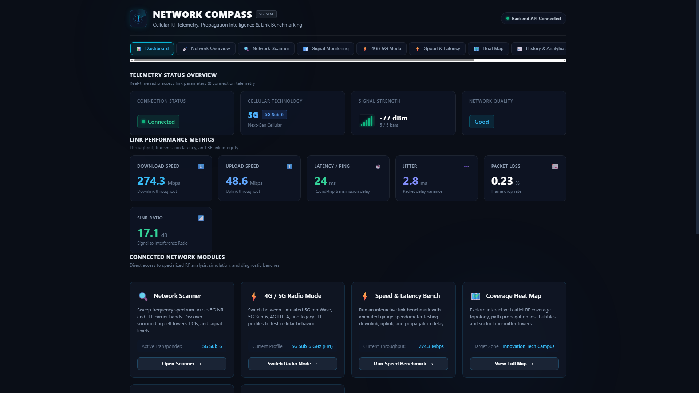
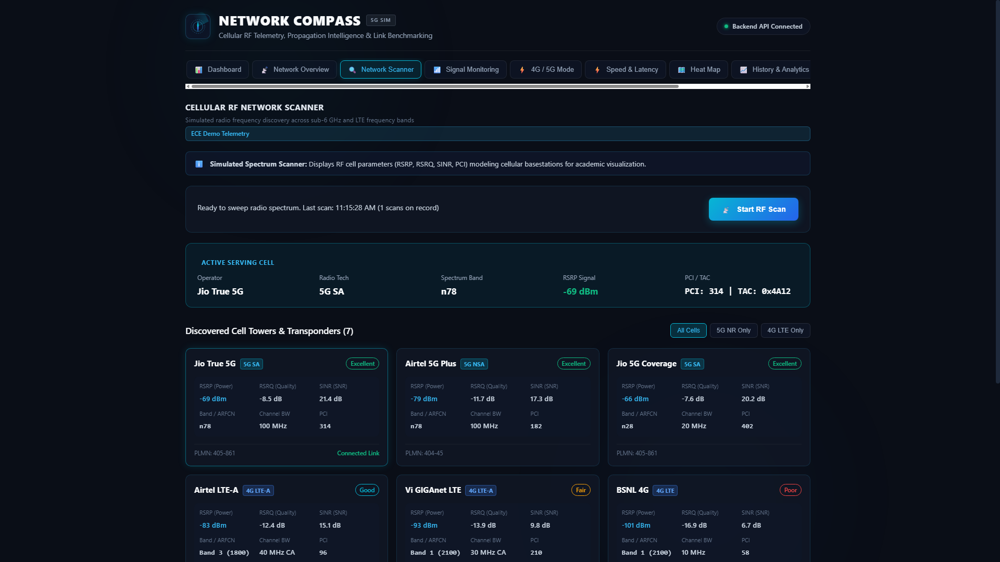
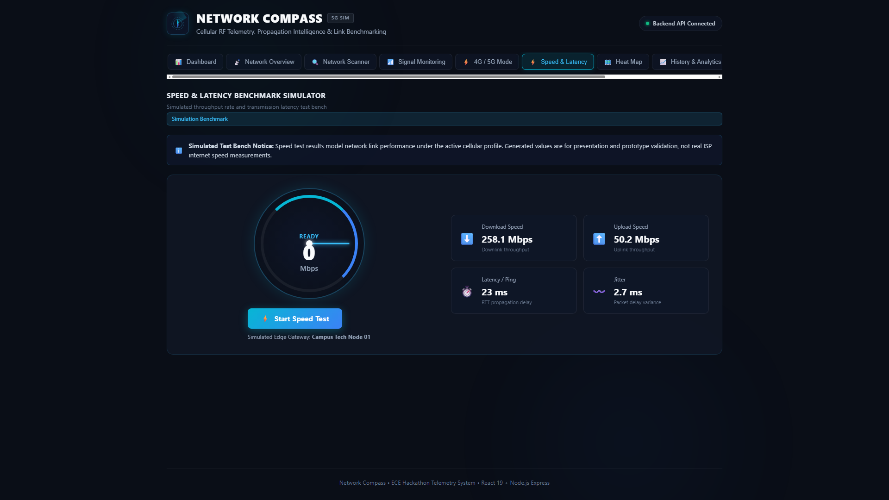
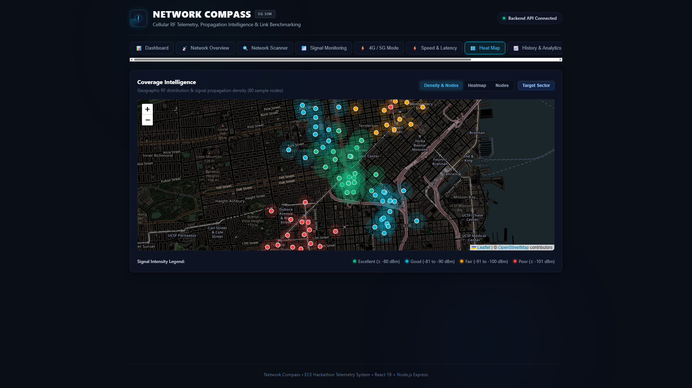
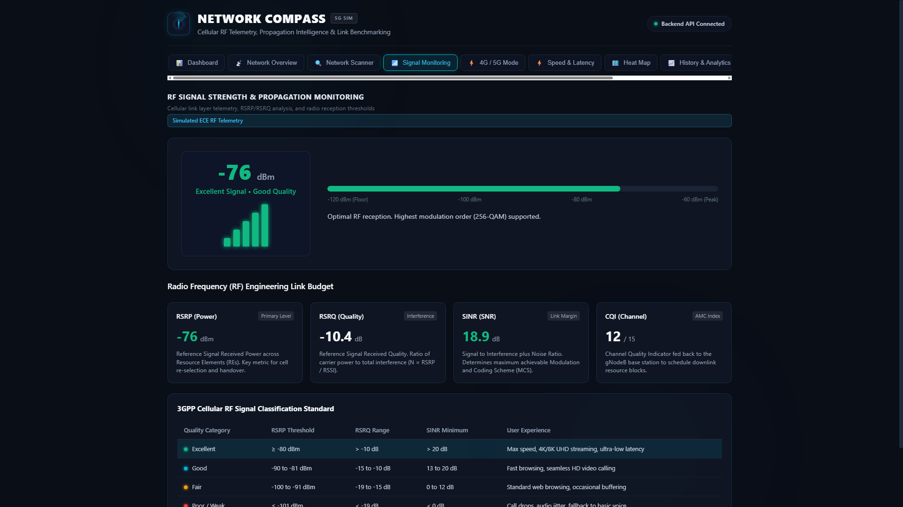
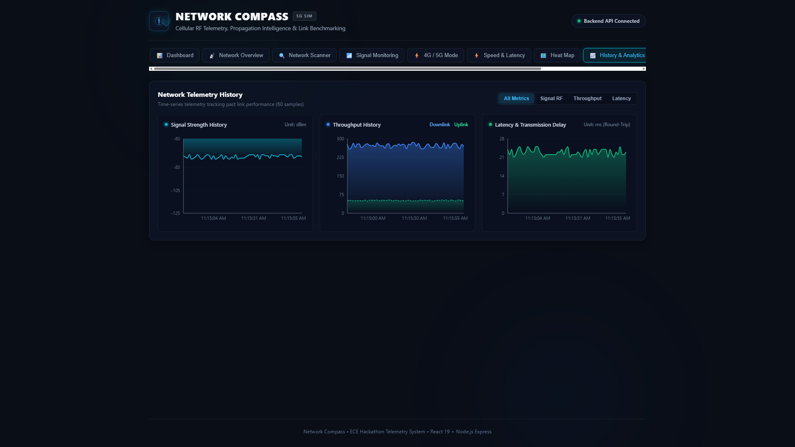

# Network Compass 🧭

> **Cellular RF Telemetry, Propagation Intelligence & Link Benchmarking System**

[](https://react.dev/)
[](https://vitejs.dev/)
[](https://nodejs.org/)
[](https://expressjs.com/)
[](https://leafletjs.com/)
[](https://recharts.org/)
[](https://oxc.rs/)
[](LICENSE)

**Network Compass** is a high-performance, full-stack cellular radio frequency (RF) telemetry monitoring, propagation intelligence, and link benchmarking dashboard. Built for an **Electronics and Communication Engineering (ECE)** demonstration, it models physical and link-layer cellular behavior across **4G LTE** and **5G NR** spectrums with mathematical fidelity, real-time analytics, and resilient offline simulation.

> [!NOTE]
> **Academic Simulation Notice**: All RF telemetry data (RSRP, RSRQ, SINR, CQI, throughput, and carrier transponders) are mathematically modeled for Electronics & Communication Engineering (ECE) demonstration purposes. They model real-world 3GPP propagation without requiring physical cellular modems or software-defined radios (SDR).

---

## 📸 Executive Dashboard Preview

<!-- Replace "screenshots/dashboard_overview.png" with your custom screenshot path if desired -->


> **Live Telemetry Cockpit**: Real-time link status, 5-bar cellular meter, signal power (dBm), downlink throughput (Mbps), round-trip latency, jitter, frame drop rate, and direct navigation to specialized RF engineering modules.

---

## 🌐 Live Demo & Instant Access

> ⏳ **Live Demo Deployment Status: netcompass-fpvozfsbv-syeedhussain-sh.vercel.app **
>
> *Once you deploy this project to Vercel or Netlify using the simple 2-minute guide below, replace this line with your verified public link:*
>
> `[🚀 Launch Live Network Compass Dashboard](https://your-app-name.vercel.app)`

### Ways to Experience the Dashboard

1. **Local 1-Click Launch (Windows)**: Run [RUN_NETCOMPASS.bat](#-quick-start-1-click-windows-launcher) to start both backend & frontend and open your browser automatically.
2. **Instant Cloud Access (Web Visitors)**: Deploy the static frontend to Vercel or Netlify in 2 minutes. The application includes a self-contained simulation engine ([src/services/mockFallback.js](file:///c:/Users/STAR/Documents/Netcompass-AG/src/services/mockFallback.js)) so web visitors can use all 10 views without installing any software or running a backend server.

---

## 🔍 Visual Module Gallery

Explore the verified views captured directly from the live running application:

| **Cellular RF Network Scanner** | **Speed & Latency Benchmark** |
| :---: | :---: |
|  |  |
| *Discovers serving & neighbor cell towers across Sub-6 GHz and LTE bands with PCI, TAC, and PLMN.* | *Real-time animated gauge speedometer bench measuring downlink, uplink, latency, and jitter.* |

| **Geographic Coverage Heat Map** | **RF Signal Strength & Link Budget** |
| :---: | :---: |
|  |  |
| *Leaflet-powered RF propagation density bubbles, sector transmitters, and customizable layer filters.* | *3GPP cellular classification standard reference table, 256-QAM indicator, RSRP, RSRQ, and SINR.* |

| **Historical Telemetry Trends & Analytics** |
| :---: |
|  |
| *Rolling multi-parameter time-series analytics (powered by Recharts) tracking signal, throughput, and latency stability.* |

---

## 🚀 Key Features (Verified in Codebase)

The system features **10 fully connected views** accessible via the top navigation bar or direct URL hash routing:

1. **Executive Dashboard (`#dashboard`)**: Live RF connection status, radio access technology (RAT) indicator, 5-bar cellular meter, link performance metrics (Download, Upload, Ping, Jitter, Packet Loss, SINR), and quick-action module hubs.
2. **Network Overview (`#overview`)**: Deep-dive physical link telemetry including RSRP, RSRQ, SINR, packet delay variation (jitter), and frame drop rate.
3. **Cellular RF Network Scanner (`#scanner`)**: Simulated RF spectrum sweep discovering carrier transponders (Jio True 5G, Airtel 5G Plus, Vi GIGAnet, BSNL 4G) with PCI, TAC, PLMN, ARFCN, and channel bandwidth.
4. **Signal Monitoring & Link Budget (`#signal`)**: Real-time signal strength gauge (in dBm), 5-bar visualizer, 3GPP cellular classification standards reference table, and modulation order indicators (up to 256-QAM).
5. **4G / 5G Radio Mode Selector (`#mode`)**: Dynamic profile switching engine between **5G mmWave (FR2)**, **5G Sub-6 GHz (FR1)**, **4G LTE-Advanced (Carrier Aggregation)**, and **4G LTE Standard**, immediately updating all dashboard telemetry.
6. **Speed & Latency Benchmark (`#speedtest`)**: Interactive throughput benchmark featuring an animated circular gauge speedometer, multi-phase testing (Ping &rarr; Downlink &rarr; Uplink &rarr; Diagnostics), and test session history.
7. **Geographic Coverage Heat Map (`#heatmap`)**: Interactive OpenStreetMap / Leaflet geographic view displaying RF propagation density nodes, sector towers, customizable layer filters (Density & Nodes, Heatmap, Nodes), and clickable tower inspector popups.
8. **Network History & Analytics (`#history`)**: Longitudinal trend charts (powered by Recharts) showing rolling time windows of signal levels, throughput fluctuations, and transmission latency.
9. **Offline Mode & Resilient Cache (`#offline`)**: Disconnected operation simulation modeling subterranean tunnels or remote dead-zones. Seamlessly falls back to `localStorage` caching with clear status badges.
10. **Settings & Diagnostic Center (`#settings`)**: Configurable telemetry polling intervals (Manual, 3s, 5s, 10s), cache purging, and live backend health check verification.

---

## 🏗️ System Architecture

```text
┌────────────────────────────────────────────────────────────────────────┐
│                        CLIENT LAYER (Browser)                         │
│                                                                        │
│   React 19 Dashboard ──► Leaflet Map ──► Recharts Analytics           │
│         │                                                              │
│         ▼                                                              │
│   src/services/api.js ──[Automatic Fallback]──► src/services/mockFallback.js
└─────────┬──────────────────────────────────────────────────────────────┘
          │ (Vite Proxy: /api  OR  Direct: http://localhost:5000/api)
          ▼
┌────────────────────────────────────────────────────────────────────────┐
│                        BACKEND REST API SERVER                         │
│                     (Node.js + Express.js :5000)                       │
│                                                                        │
│   ├── /api/health              (Health check & uptime diagnostics)     │
│   ├── /api/telemetry/current   (Real-time RF link parameters)          │
│   ├── /api/telemetry/history   (Rolling time-series telemetry buffer)  │
│   ├── /api/telemetry/profiles  (4G/5G radio simulation profiles)       │
│   ├── /api/scanner/scan        (RF spectrum transponder sweep)         │
│   ├── /api/speedtest/run       (Throughput & latency benchmark bench)  │
│   └── /api/coverage/points     (Geographic RF propagation nodes)       │
└────────────────────────────────────────────────────────────────────────┘
```

---

## ⚡ Quick Start: 1-Click Windows Launcher

For Windows users, the repository includes a self-healing, automated batch launcher: **`RUN_NETCOMPASS.bat`**.

### How to Run

1. Clone or download the repository to your PC:

   ```bash
   git clone https://github.com/syeedhussain-sh/Netcompass-AG.git
   cd Netcompass-AG
   ```

2. Double-click **`RUN_NETCOMPASS.bat`** (or execute `.\RUN_NETCOMPASS.bat` in Command Prompt / PowerShell).

### What RUN_NETCOMPASS.bat Automates

- **Environment Verification**: Confirms `node` (v18+) and `npm` are installed and available in PATH.
- **Auto-Installation**: Automatically runs `npm install` for both root and backend if `node_modules` are missing.
- **Backend Startup**: Launches the Express REST API in a dedicated server window on port 5000.
- **Live Health Check**: Pings `http://localhost:5000/api/health` with up to 10 automated retry attempts.
- **Frontend Startup**: Starts the Vite development server on port 5173.
- **Browser Automation**: Automatically launches your default web browser directly to `http://localhost:5173`.
- **Interactive Console Menu**:
  - `[H]` Query live backend health check endpoint
  - `[O]` Re-open dashboard in browser
  - `[S]` Open backend REST API in browser
  - `[Q]` Cleanly exit launcher controller

---

## 🛠️ Manual Installation (Cross-Platform: Windows, macOS, Linux)

If you prefer starting services manually from the terminal:

### 1. Prerequisites

- **Node.js**: v18.0.0 or higher
- **npm**: v9.0.0 or higher

### 2. Install Dependencies

```bash
# Install frontend dependencies
npm install

# Install backend dependencies
cd backend
npm install
cd ..
```

### 3. Run Application

Open two terminal windows:

**Terminal 1 (Backend API on Port 5000):**

```bash
npm run server
```

**Terminal 2 (Frontend Dashboard on Port 5173):**

```bash
npm run dev
```

### 4. Open in Browser

- **Frontend Dashboard**: [http://localhost:5173](http://localhost:5173)
- **Direct View Links**:
  - Main Dashboard: [http://localhost:5173/#dashboard](http://localhost:5173/#dashboard)
  - Network Scanner: [http://localhost:5173/#scanner](http://localhost:5173/#scanner)
  - Speed Test: [http://localhost:5173/#speedtest](http://localhost:5173/#speedtest)
  - Coverage Map: [http://localhost:5173/#heatmap](http://localhost:5173/#heatmap)
  - Signal Monitor: [http://localhost:5173/#signal](http://localhost:5173/#signal)
  - History & Trends: [http://localhost:5173/#history](http://localhost:5173/#history)
- **Backend REST API**: [http://localhost:5000/api/health](http://localhost:5000/api/health)

---

## 🌐 How Visitors Can View & Deploy Live

> **Important Note**: GitHub is a code repository and does not execute Windows batch files (`.bat`) or host dynamic Node.js servers natively. To allow visitors to open the live dashboard via a web link without downloading anything, deploy using one of the following methods:

### Option 1 - Instant Static Frontend Deployment (Vercel / Netlify / GitHub Pages)

Because Network Compass contains a **built-in Resilient Offline Demo Provider** (`src/services/mockFallback.js`), the frontend can be deployed completely standalone! If the backend API is unreachable, the dashboard automatically generates simulated live telemetry, speed tests, and scanner results.

1. **Deploy to Vercel**:
   - Push repository to GitHub.
   - Import the repository on [Vercel](https://vercel.com).
   - Build Command: `npm run build`
   - Output Directory: `dist`
   - Deploy! Visitors can immediately interact with the full dashboard.

### Option 2 - Full-Stack Cloud Deployment (Frontend + Live Backend API)

For a connected full-stack deployment with live REST endpoints:

1. **Deploy Backend**:
   - Deploy the `backend/` folder to **Render**, **Railway**, or **Fly.io**.
   - Build Command: `npm install`
   - Start Command: `node src/server.js`
   - Note the assigned backend URL (e.g. `https://netcompass-api.onrender.com`).

2. **Deploy Frontend**:
   - Deploy root repository to **Vercel** or **Netlify**.
   - Set environment variable: `VITE_API_URL=https://netcompass-api.onrender.com/api`
   - Deploy!

---

## 🔌 REST API Specification

| Method | Route | Description | Sample Output |
| :--- | :--- | :--- | :--- |
| `GET` | `/api/health` | Health check & uptime | `{"success":true,"uptime":42.5}` |
| `GET` | `/api/telemetry/current` | Active RF link snapshot | `{"connectionStatus":"Connected","signalStrength":-76}` |
| `GET` | `/api/telemetry/history` | Rolling telemetry records (`?limit=60`) | `{"success":true,"data":[...]}` |
| `GET` | `/api/telemetry/profiles` | Available 4G/5G profiles | `[{"id":"5g-sub6","name":"5G Sub-6 GHz"}]` |
| `POST` | `/api/telemetry/profile` | Switch radio profile | `{"activeProfileId":"5g-mmwave"}` |
| `POST` | `/api/scanner/scan` | Trigger RF spectrum sweep | `{"discoveredTowers":[...]}` |
| `GET` | `/api/scanner/history` | Past RF scan session logs | `{"success":true,"data":[...]}` |
| `POST` | `/api/speedtest/run` | Execute benchmark test | `{"downloadSpeed":261.8,"latency":24}` |
| `GET` | `/api/speedtest/history` | Speed test history logs | `{"success":true,"data":[...]}` |
| `GET` | `/api/coverage/points` | Geographic RF nodes & sectors | `{"center":{...},"points":[...]}` |

---

## 🛠️ Troubleshooting

- **Port 5000 or 5173 is already in use**:

  Check running processes or terminate existing instances:

  ```powershell
  Get-Process node -ErrorAction SilentlyContinue | Stop-Process -Force
  ```

- **Backend API status shows "Offline Demo Cache"**:

  - Ensure the backend server is running with `npm run server` or through `RUN_NETCOMPASS.bat`.
  - Check health directly: `curl http://localhost:5000/api/health`.

- **Map tiles not displaying**:

  - The coverage heat map requires an active internet connection to download OpenStreetMap tile layers.

---

## 👥 Project & Academic Information

- **Project**: Network Compass
- **Domain**: Telecommunications / Cellular Radio Frequency (RF) Engineering
- **Department**: Electronics and Communication Engineering (ECE)
- **Technologies**: React 19, Vite 8, Node.js, Express.js, Leaflet, Recharts, Oxlint
